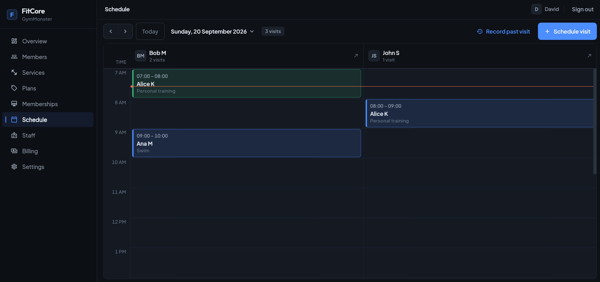

# FitCore

Multi-tenant gym CRM. One platform, many gyms. Each gym keeps its own members, staff, plans, memberships, and visits.

**Live app → [https://fitcore-landingpage.astibosoft.com](https://fitcore-landingpage.astibosoft.com)**



---

## Why this project exists

FitCore is being built for gyms I am approaching now. The app is deployed. It is meant to change as feedback comes in from those gyms. This version is the core: the operations every gym needs, as a base that later per-tenant setup can sit on.

---

## Core Features

**Platform**
- Two-step platform admin sign-in
- Invitation-only gym registration
- List and cancel gyms

**Gym owner**
- Invite-only staff and members
- Assignes memberships
- Visits booked on an active membership

**Staff**
- Own schedule, including resolving and voiding visits

**Member**
- Own profile and visits

---

## Tech stack

| Layer | Technologies |
|--------|----------------|
| Client | Flutter · Dart |
| API | .NET 10 · ASP.NET Core · EF Core · JWT |
| Data | PostgreSQL |
| Auth | JWT · BCrypt |
| Deploy | Docker Compose · Linux VPS · nginx |

---

## Architecture (overview)

The API is organized in vertical slices.

### Deployment shape (VPS)

```text
Browser
    │
    ▼
nginx (Infra)
  ├── /      → Flutter web
  └── /api/  → fitcore-api (:8080)
                    │
               postgres (database: fitcore)
```

Edge nginx and the shared Postgres live in [Infra](https://github.com/davidzdravkovic/Infra). This service joins the external `edge` and `database` networks as **`fitcore-api`**.

**Repositories**

| Repo | Role |
|------|------|
| [FitCore](https://github.com/davidzdravkovic/FitCore) | .NET API · **this repo** · `deploy/` |
| [FitCore.Client](https://github.com/davidzdravkovic/FitCore.Client) | Flutter client |
| [Infra](https://github.com/davidzdravkovic/Infra) | Shared nginx + Postgres on the VPS |

### Domain

The core of this app is two concepts: the member lifecycle, and the calendar. This section describes the design of how their main constraints are protected.

**Member lifecycle.** Members, memberships, and visits each have their own states, and together they are one domain context. Only certain combinations of those states are valid. Each lifecycle represents a situation where all entities are in certain state that together form valid business context.
For example:
- `Paused member` needs to have expired or cancelled memberships that means there should be no active schedules for that member.
- `Active member` needs to have at least one active membership, meaning there are unresolved or disposable visits for an active membership.

The way of protecting the state machine is a single direction of influence. An outside action changes a visit, that can change the membership, and that can change the member.

```text
Outside action → Visit → Membership → Member
```

Completing the last session can expire the membership. When none remain active, the member can pause.

Cancelling a member does not run that cascade. It is refused while a membership is still active. Cancelling a membership does: its scheduled visits are cancelled first, and the member is paused only when no active membership remains.

```text
Cancel membership → visits cancelled → Membership → Member
```

The member is paused only when no active membership remains.  


**Calendar.** The calendar is protected with pessimistic locks, so two writes cannot leave it inconsistent.

The state rules and the calendar rules are written down under [FitCore.Api/docs](FitCore.Api/docs).

---

## Security

- **Auth:** invite-only. I send an invitation only to the gym admin. The admin creates or imports staff and members, then invites them. From that link they set their credentials. JWT after login. Passwords hashed with BCrypt. Roles: platform admin, tenant owner, staff, member.
- **Tenant:** organization routes require an active tenant. Queries stay inside that gym.
- **Secrets:** in production, `JWT_SIGNING_KEY`, the database password, and AWS keys are environment variables. On the VPS those are filled in from `deploy/.env.example`. Local dev uses `appsettings.Development.json`, which is not committed.
- **Tokens:** platform login, gym invitation, and staff/member invite links are single-use and expire. Only a hash is stored, and a new link invalidates the previous unused one.

---

## Run

**Local.** `docker-compose.yml` starts Postgres only.

```bash
docker compose up -d
```

Then run the API with `dotnet run --project FitCore.Api`.

**Production.** `deploy/compose.vps.yaml` runs the API on the VPS. It does not start Postgres or nginx. Those come from [Infra](https://github.com/davidzdravkovic/Infra): Postgres on the `database` network, nginx on the `edge` network. Steps: [deploy/DEPLOY.md](deploy/DEPLOY.md).

---

## Design notes

- [Identities](FitCore.Api/docs/architecture/phase-01-identities-data-model.md)
- [States](FitCore.Api/docs/architecture/States.md)
- [Domain evolution](FitCore.Api/docs/architecture/ADR-001-domain-model-evolution.md)
- [Lock order](FitCore.Api/docs/architecture/row-lock-ordering.md)
- [Invariants](FitCore.Api/docs/concurrency/Invariants.md)

---

## License

Personal portfolio project. Ask before reusing commercially.
